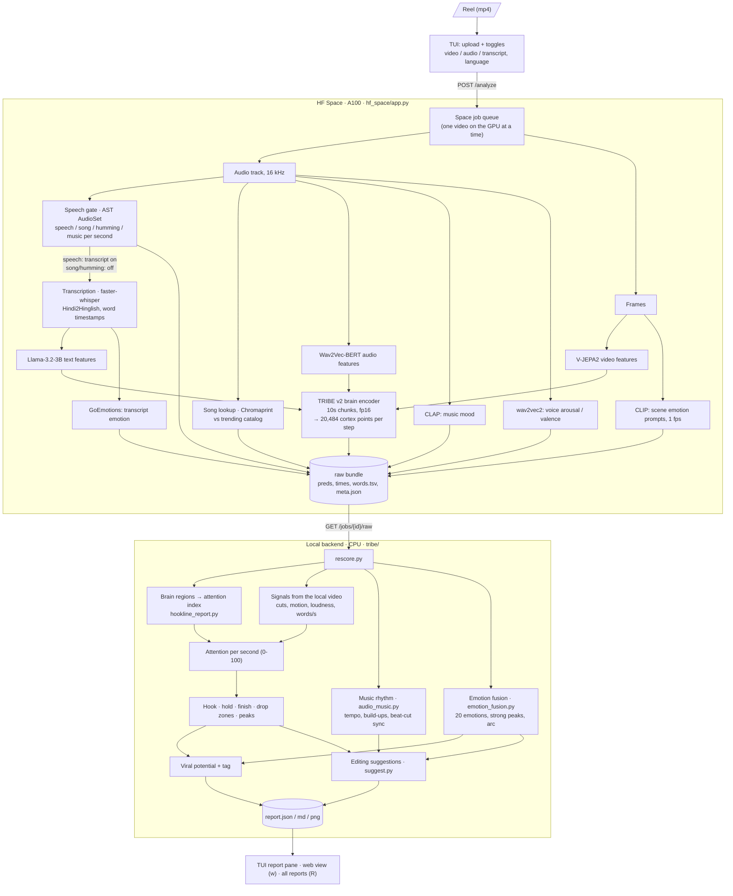

# Hookline architecture: what runs where

Hookline has three parts:

1. **TUI** on your machine (`tui.py`): you pick a video here and read the result.
2. **GPU Space** on Hugging Face (`hf_space/`): runs the heavy models and returns raw numbers. It does not decide scores.
3. **Local backend** on your machine (`backend/app.py`, port 8000): turns the raw numbers into the report, and serves the web view.

All scoring logic lives locally. A formula change takes effect after a regenerate; no GPU run and no Space redeploy are needed.

```
 ┌──────────── your machine ─────────────┐            ┌──── Hugging Face Space (A100) ────┐
 │                                        │  1 upload  │                                   │
 │  tui.py ───────────────────────────────┼───────────▶│  POST /analyze  → job queue        │
 │   │  polls progress / ETA every 1s     │◀───────────┤  GET  /jobs/{id} (step, chunk, ETA)│
 │   │                                    │            │                                   │
 │   │                                    │            │  TRIBE v2: video + audio + text    │
 │   │                                    │            │  speech gate, Hinglish ASR,       │
 │   │                                    │            │  song lookup, emotion channels    │
 │   │ 3 job done → POST /import/{id}     │  4 raw zip │                                   │
 │   ▼                                    │◀───────────┤  GET  /jobs/{id}/raw              │
 │  backend/app.py (:8000)                │            └───────────────────────────────────┘
 │   ├─ tribe/rescore.py  fetch + rebuild │
 │   ├─ tribe/hookline_report.py scores   │
 │   ├─ emotion_fusion / audio_music      │
 │   ├─ suggest.py  editing suggestions   │
 │   └─ writes backend/out/<job>/report.* │
 │  5 TUI shows report; `w` opens web view│
 └────────────────────────────────────────┘
```

## A full run, step by step

| # | What happens | Where | Code |
|---|---|---|---|
| 1 | You pick a reel (or your own file with `o`) and press `f`. The video is uploaded to the Space along with the modality toggles (video / audio / transcript) and the language setting. | TUI → Space | `tui.py` `action_full`, `post_video` |
| 2 | The Space queues the job and runs the models: TRIBE v2 feature extractors (V-JEPA2 video, Wav2Vec-BERT audio, Llama-3.2 text), then TRIBE's brain predictions. It also runs the speech gate, Hinglish transcription, trending-song lookup and the emotion channels (CLIP, CLAP, voice, GoEmotions). Progress, the current chunk and an ETA are published on `GET /jobs/{id}`. | Space (GPU) | `hf_space/app.py`, `hf_space/emotion.py`, `hf_space/audio_match.py`, `hf_space/tribe_analyze.py` |
| 3 | The TUI polls every second and shows the step, chunk and ETA. You can stop (`x`) or restart (`ctrl+r`) the job. When the job finishes, the TUI asks the local backend to import it. | TUI → backend | `tui.py`, `POST /import/{space_job}` |
| 4 | The backend downloads the raw bundle (`preds` float16, `times`, `words.tsv`, `meta.json` with the emotion/audio extras) into `backend/out/s-<job>/raw/` and keeps it. | Space → backend | `tribe/rescore.py` `fetch_raw` |
| 5 | The backend builds the report from the raw data plus the local video: hook/hold/finish/virality scores, peaks and drop zones, music rhythm, emotion fusion and strong-emotion peaks, and editing suggestions. It writes `report.json`, `report.md` and `report.png`. Any older report for the same video is replaced (moved to `backend/out/.replaced/`). | Backend (CPU) | `tribe/rescore.py` `rescore`/`supersede`, `tribe/hookline_report.py` |
| 6 | The TUI shows the report. `w` opens the web view, which includes the video player, chart, emotion dots and transcript. `R` opens the list of all reports, sorted by viral potential. | TUI / browser | `GET /report/{id}/view`, `GET /reports` |

## How a video is analysed

### Overall flow



### What we analyse: seen, heard, said

All of this runs on the Space (GPU) unless marked local. Every signal is per second, so it can be lined up on one timeline.

| Channel | What we look at | Model / method | Why it matters |
|---|---|---|---|
| **Seen** | The frames over time | V-JEPA2 ViT-g (TRIBE's video extractor) | Feeds the brain model: what the visual system responds to |
| Seen | Scene emotion: the situation on screen ("an injured animal", "a funny prank", "a rescue") | CLIP ViT-B/32 (LAION), 1 frame per second against ~40 situation prompts from `tribe/taxonomy.py` | Which emotion the scene evokes (appraisal theory: the situation, not the look) |
| Seen (local) | Scene cuts and motion | ffmpeg scene detection, frame differences | Visual change keeps attention; long static stretches lose it |
| **Heard** | The audio over time | Wav2Vec-BERT 2.0 (TRIBE's audio extractor) | Feeds the brain model: what the auditory system responds to |
| Heard | Audio type per second: speech, singing, humming, music, laughter, silence | AST AudioSet classifier (2s windows, 1s hop) | The speech gate: decides if words are worth transcribing; also detects laughter, gasps, cheering |
| Heard | Which song it is | Chromaprint fingerprint vs `trending_audio.json` | Context only ("trending audio"); never a score input |
| Heard | Music mood ("slow mournful melody", "hype edm beat") | CLAP (laion/clap-htsat-fused), 4s windows | Emotion carried by the soundtrack when nobody speaks |
| Heard | Voice energy and tone | audeering wav2vec2 (arousal / valence), seconds with speech only | A lively or shaking voice backs high-arousal moments |
| Heard (local) | Loudness, tempo, build-ups, drops, key, beat-cut sync | librosa (`tribe/audio_music.py`) | Rhythm and energy of the edit |
| **Said** | The words, with timestamps | faster-whisper with a Hindi/English/Hinglish model; guards drop hallucinated text | Feeds the brain model; captions for suggestions |
| Said | Meaning of the words | Llama-3.2-3B (TRIBE's text extractor) | Feeds the brain model: what the language system responds to |
| Said | Emotion in the words | GoEmotions classifier per transcript segment | Laughter, anger, sadness etc. in what is said |
| **Brain** | Predicted cortex response to all of the above | TRIBE v2: 20,484 points on the cortex per time step | The core signal: how engaged a typical viewer's brain would be |

When the speech gate finds a song or humming (no real speech), the transcript is switched off and the reel is judged on what is seen and heard. Lyrics are not treated as speech.

### How the numbers become the report (local, `tribe/hookline_report.py`)

1. **Brain → attention.** TRIBE's cortex points are averaged into regions: visual, auditory, language, attention and default-mode. Engagement = the sensory, language and attention regions minus half of the default-mode region, which is active when the mind wanders.
2. **Signals.** Cuts, motion, loudness and words per second are measured from the local video.
3. **Attention per second.** Attention = 60% brain engagement + 40% signals. It is normalised within the video and squashed to 0-100, so the average second of any reel is about 50. That is why scores compare moments inside a video, not videos with each other.
4. **Hook.** Attention in the first 3s, plus bonuses for speech in the first 1.5s and a cut or movement in the first 2s, minus a penalty for a silent start.
5. **Hold and finish.** A simulated viewer curve: viewers lost in the hook window based on the hook score, then a small per-second loss that grows when attention is low. Finish is the share still watching at the end; hold is finish relative to hook.
6. **Moments.** Peak attention, strongest and weakest 3s windows, drop zones (attention below 35 for 2s or more), and peak counts per window (window = 10% of the reel, max 10s).
7. **Emotion** (`tribe/emotion_fusion.py`). Scene, music, voice, words and sounds are fused into one track over 20 emotions (after Cowen & Keltner). Strong emotions are only real spikes of laughter, awe, outrage, sorrow, being moved, fear, disgust or empathic pain. The report also gives the whole-video arc, such as a sad start that resolves into hope. These show as coloured dots on the attention chart.
8. **Viral potential.** 40% hook, 25% share of the reel without drops, 20% share of strong-attention seconds, and 15% ending. Strong emotional peaks then lift it toward 100, closing at most half the gap. The result maps to a tag: Low reach, Average, Above average, Popular or Viral potential. This is an uncalibrated heuristic; `tribe/fit_virality.py` will replace the weights once fitted on real view data.
9. **Editing suggestions** (`tribe/suggest.py`). Each drop zone is compared with the reel's own best stretch. For example: "no cut for 4s, your best part cuts every 1.2s". Each suggestion names one concrete edit at a timestamp (trim, open on the best moment, end earlier, zoom, speed up, sound lift, on-screen text) and is ranked by estimated viewers lost. `V` renders an edit and re-runs it through TRIBE to check whether it actually helps.
10. **Output.** `report.json`, plus `report.md` and a `report.png` chart. The TUI and web view read the same JSON, including the transcript that was used and the audio and song context.

## Other paths

- **Preview (`p` / Enter):** fully local and takes seconds. The backend computes the real video and audio signals and uses a synthetic stand-in for the brain predictions. It produces the same report schema, marked `preview: true`. Code: `backend/app.py` `POST /analyze?mode=preview`, `run_preview`.
- **Regenerate (`g`):** rebuilds a report from the raw data already stored, using the current formulas. It's local and needs no GPU. Code: `POST /report/{id}/regenerate`, `tribe/rescore.py`. To re-score everything: `python tribe/rescore.py`.
- **Verify edits (`V`):** renders the top suggested edits as real videos with ffmpeg, runs each one on the Space, and compares the result against a re-encoded, unedited baseline. Code: `tribe/verify.py`, `tribe/edit_render.py`, `POST /report/{id}/verify`.
- **Space control (`S`):** shows the Space's live status and lets you ping, start, restart or stop it. It uses the Hugging Face Hub API directly from the TUI. Code: `tui.py` `SpaceScreen`.
- **Calibration and fitting (offline scripts):**
  - `tribe/calibrate_prompts.py` builds per-prompt emotion calibration. It only takes effect once there are at least 15 reels.
  - `tribe/fit_virality.py` fits virality weights on outlier vs low-view reels. This is a dry run and isn't applied yet.

## Who owns which file

| Area | Files | Runs on |
|---|---|---|
| Terminal UI | `tui.py`, `run-demo.sh` | your machine |
| Local backend, web report | `backend/app.py`, `backend/out/` (reports, raw data; git-ignored except `demo/`) | your machine |
| Scoring and report logic (source of truth) | `tribe/hookline_report.py`, `tribe/emotion_fusion.py`, `tribe/taxonomy.py`, `tribe/audio_music.py`, `tribe/suggest.py` | your machine |
| Re-scoring, verification | `tribe/rescore.py`, `tribe/verify.py`, `tribe/edit_render.py` | your machine (+ Space for verify) |
| GPU service | `hf_space/app.py`, `hf_space/emotion.py`, `hf_space/audio_match.py`, `hf_space/tribe_analyze.py`, `hf_space/Dockerfile` | HF Space `wlddhq/hookline-tribe` |
| Shared copies | `hf_space/{hookline_report,emotion_fusion,taxonomy,audio_music,suggest}.py` are copies of the `tribe/` files, used for the Space's own fallback report | Space |
| Space helper | `space.sh` (status / bring up from the shell) | your machine |

**Keeping the copies in sync:** edit the `tribe/` file first, copy it to `hf_space/`, then upload with
`hf upload wlddhq/hookline-tribe hf_space . --repo-type space`.
Local reports never depend on the Space's copies.

## Rules that hold everywhere

- Scores judge the video, never the account. Follower count and handle are never inputs; page size appears only as display context.
- Scores are within-video, uncalibrated heuristics (the average second is about 50). They are not measured retention.
- Every prediction combines what is seen, heard and said over time.
- Videos, model weights and raw predictions are never committed. `samples/` is hackathon-only data and is git-ignored.

See `AGENTS.md` and `.ai/rules/` for the full contracts.
